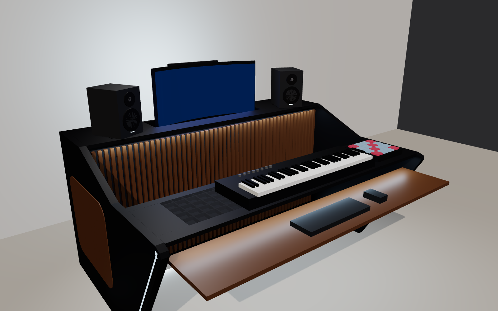
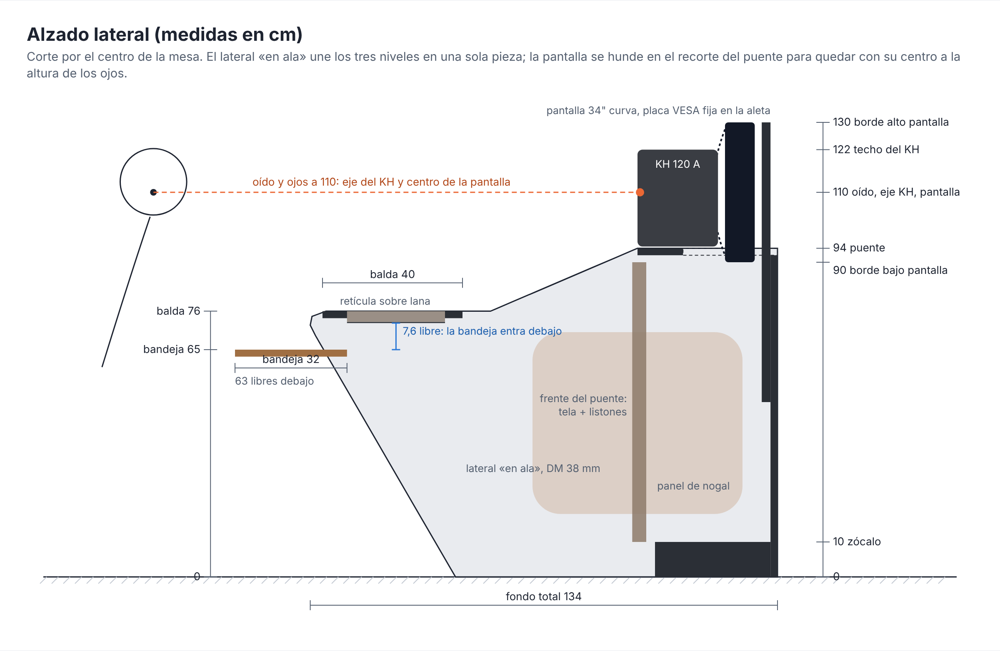
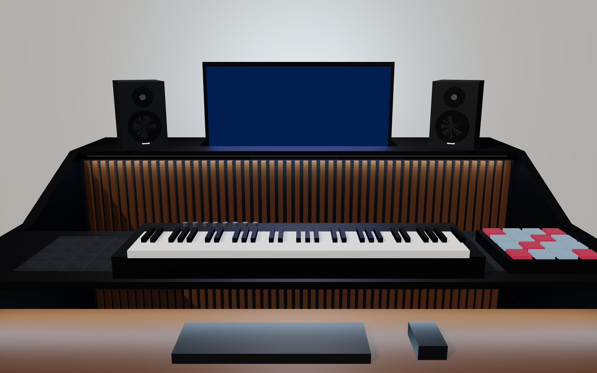
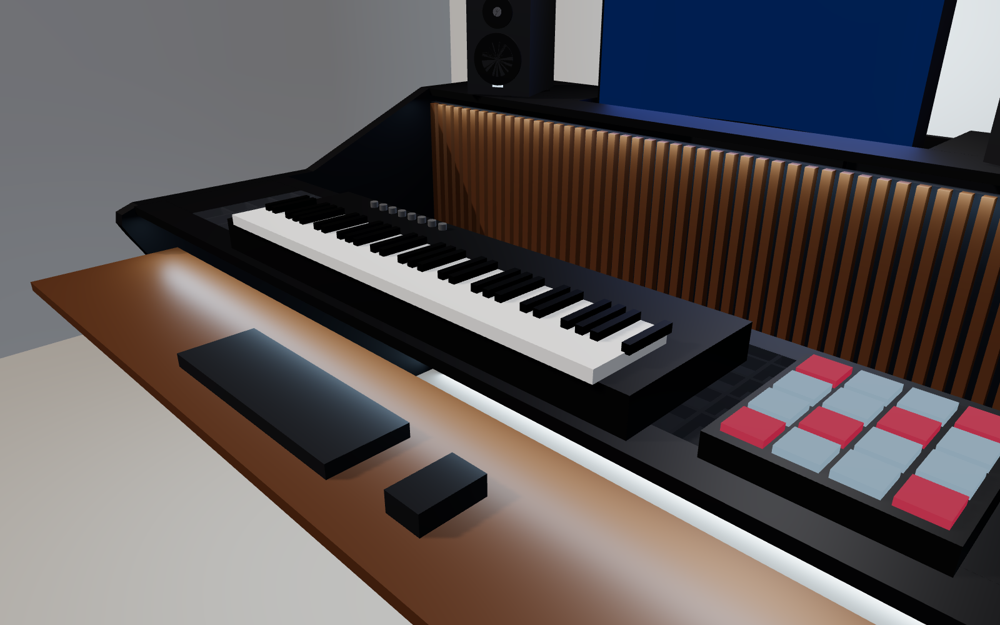
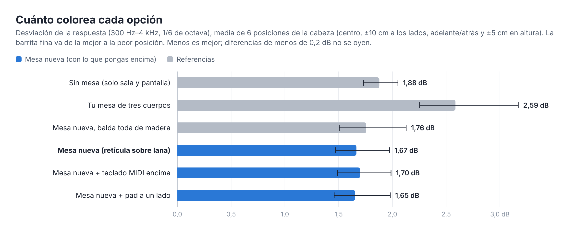
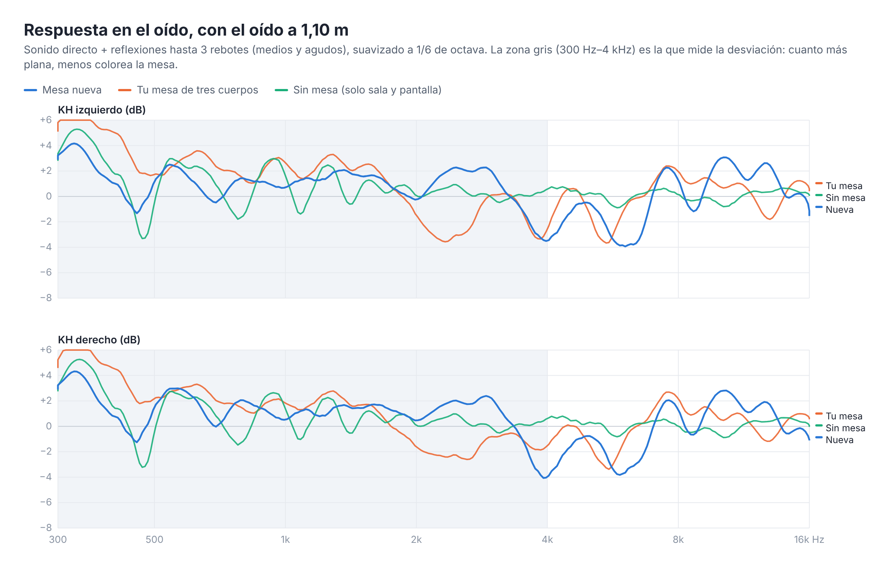
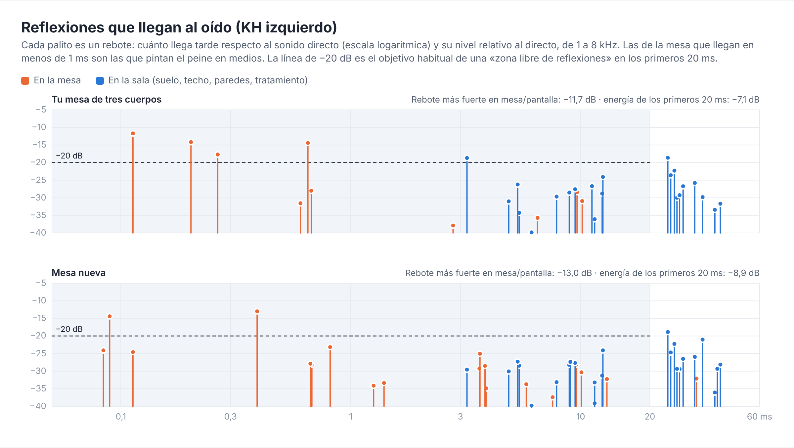

# Mesas acústicas para el Estudio v0.05

Diseños de mesa para los KH 120 A, calculados con la pestaña «Medios y agudos» de Acustica3D (método de la imagen con difracción por zonas de Fresnel y la directividad del KH 120 medida por Neumann) sobre el modelo `Estudio_v0.05.skp`.

| | Archivo para SketchUp | Lámina |
|---|---|---|
| **Con lana** en el tablero | [`Mesa_con_lana.dae`](Mesa_con_lana.dae) | [`Mesa_con_lana.png`](Mesa_con_lana.png) |
| **Sin lana**, con sitio para teclado, teclado MIDI y torre | [`Mesa_sin_lana.dae`](Mesa_sin_lana.dae) | [`Mesa_sin_lana.png`](Mesa_sin_lana.png) |
| **Tres cuerpos mejorada**: tu idea de cuerpos que se meten uno dentro de otro, con ruedas y los KH sobre la mesa | [`Mesa_tres_cuerpos.dae`](Mesa_tres_cuerpos.dae) | [`Mapa_tres_cuerpos.png`](Mapa_tres_cuerpos.png) |
| **Mesa útil con diseño**: instrumentos a mano, bandeja debajo, pantalla a la altura de los ojos (oído a 1,10 m) | [`Mesa_util_diseno.dae`](Mesa_util_diseno.dae) | [`Mesa_util_negro.png`](Mesa_util_negro.png) · [`Alzado_mesa_util.png`](Alzado_mesa_util.png) |

Y el **mapa de zonas sensibles** con tu diseño original encima: [`Mapa_zonas_sensibles.png`](Mapa_zonas_sensibles.png).

Los `.dae` se generan con `node mesa/gen_mesas.mjs`.

## Resultado

Respuesta de cada KH en el oído (directo y reflexiones hasta 3 rebotes), de 300 Hz a 4 kHz en 1/6 de octava. Es la media de seis posiciones de la cabeza: la dibujada, centrada, 10 cm adelante y atrás, y 5 cm más alta y más baja. La pantalla está en todas.

| Mesa | Desviación de la respuesta | Reflexiones fuertes¹ | Energía en los primeros 20 ms² |
|---|---|---|---|
| Tu diseño de tres cuerpos (el dibujado en el v0.05) | 2,73 dB (2,3–3,1) | 6,8 | −8,9 dB |
| **Tres cuerpos mejorada** | **1,29 dB** (1,2–1,4) | 5,2 | −11,1 dB |
| **Con lana** | **1,12 dB** (0,9–1,3) | 0,8 | −13,9 dB |
| **Sin lana** | **1,29 dB** (1,0–1,5) | 1,8 | −12,6 dB |

¹ Por encima de −20 dB en los primeros 20 ms, de media por posición.
² Suma de las reflexiones respecto al directo, de 1 a 8 kHz.

El problema de una mesa con los KH detrás es el rebote del sonido en el tablero. Llega menos de 1 ms después del directo y a unos −8 dB, y hace un filtro en peine en medios. El punto de rebote lo fijan los KH y el oído: está a mitad de camino, a unos 75 cm por delante del oído (Y ≈ 4,92 m), a cualquier altura de tablero. Cada mesa lo resuelve de una forma:

- **Con lana:** el tablero sigue ahí, pero el rebote cae en una franja de lana de roca.
- **Sin lana:** no hay tablero en ese punto. Lo poco que queda delante está inclinado y desvía su rebote hacia el pecho, no al oído.

## Mesa con lana

- **Tablero** de 185 × 88 cm, plano, a 73 cm; desde Y 4,62 m (el borde delantero de la mesa actual) hasta 5,50 m.
- **Franja de lana de roca** de 80 kg/m³ y 5 cm de grosor, forrada de tela fina. Va a todo el ancho menos 3 cm por lado, con 30 cm de fondo, empezando a 23 cm del borde delantero. Delante quedan 23 cm para el teclado. Con fieltro en vez de lana, la desviación sube a 1,7 dB.
- **KH en pies de suelo** detrás de la mesa, sin tocarla, con la bandeja a 95 cm.
- **Pantalla** sobre la mesa, al fondo: 9 cm más baja que ahora, 5 cm más cerca de ti e inclinada 8° hacia atrás.

## Mesa sin lana

- **Franja de 185 × 32 cm** para el teclado del ordenador y el ratón. El borde delantero va a Y 4,50 m, 12 cm más cerca de ti que la mesa actual, y a 73 cm de altura.
  - Está **inclinada 10°**: el borde de atrás queda 5,6 cm más alto, como un tablero de dibujo.
  - Así, lo que rebota en ella va hacia tu pecho, unos 40 cm por debajo del oído, y su punto de rebote se sale de la franja.
  - Inclinarla al revés (el borde de delante más alto) empeora: la franja pasa a hacer de espejo hacia el oído.
  - Plana, la desviación es de unos 1,7 dB; a 10°, 1,3 dB. Más inclinada mejora poco.
- **Bandeja extraíble para el teclado MIDI**, de 105 × 30 cm, bajo la franja y a 60 cm de altura. Cabe un teclado de 61 teclas de hasta unos 28 cm de fondo y 10 cm de alto. Guardada o sacada, apenas cambia nada.
- **Torre del PC en el suelo**, bajo el extremo izquierdo (X 1,18–1,38 m, Y 4,80–5,25 m), fuera de los caminos del sonido de los KH al oído. En el `.dae` hay una torre y un teclado de ejemplo para ver el sitio: cámbialos por los tuyos.
- **Detrás no hay tablero.** La pantalla va en un brazo VESA sujeto al borde de atrás de la franja (la Samsung C34J791 admite VESA 100 × 100; compruébalo en su manual), en el mismo sitio que en la mesa con lana. Un tablero detrás, aunque sea plano y bajo, devuelve el rebote: la desviación sube a unos 3 dB.
- **KH en pies de suelo**, como en la otra.
- **Estructura:** los dos laterales del `.dae` son orientativos. Con 32 cm de fondo conviene una estructura de patas metálicas o un travesaño bajo atrás.

## Tu idea de tres cuerpos

La mesa dibujada en el v0.05 tiene tres cuerpos con ruedas que se meten uno dentro de otro:
- **alto:** a 92 cm, para los KH;
- **medio:** inclinado hacia los KH, para la pantalla y aparatos MIDI;
- **bajo:** a 66 cm, para el teclado y el ratón.

La inclinación del medio se eligió con un espejo en SketchUp: desde el oído no se ven los KH reflejados.

### Por qué no funciona

La prueba del espejo es óptica de rayos. Solo vale cuando la superficie es mucho más grande que la longitud de onda, y en medios no lo es: a 1 kHz la onda mide 34 cm y a 300 Hz más de un metro. El sonido no rebota en un punto. Rebota en una zona de 30–40 cm alrededor del punto de rebote (la zona de Fresnel), y los bordes de los tableros radian sonido hacia todos los lados (difracción).

El [mapa de zonas sensibles](Mapa_zonas_sensibles.png) lo enseña. Cada punto indica cuánto sonido manda a tu oído un borde de tablero que esté ahí. Rojo: mucho; blanco: nada. El **punto de rebote** cae siempre a mitad de camino entre el KH y el oído, a cualquier altura: unos 75 cm por delante de ti (Y ≈ 4,92 m). Con el cálculo completo, tus tres cuerpos dan tres reflexiones de unos −15 a −19 dB en el primer milisegundo. Juntas hacen un filtro en peine; con el KH izquierdo, por ejemplo, hay un valle de −7 dB entre 800 Hz y 1,3 kHz:

| Cuerpo | Qué pasa | Nivel (1–8 kHz) | Retardo |
|---|---|---|---|
| **Bajo** (teclado) | Está justo en el punto de rebote. El espejo no ve el KH porque lo tapa el borde del cuerpo medio por 9 cm, pero en medios el sonido rodea ese borde. | −15 dB | 1 ms |
| **Medio** | El tablero inclinado está bien (el espejo acierta), pero su borde delantero, a 82 cm, queda dentro de la zona roja y difracta. | −15 dB | 0,4–0,5 ms |
| **Alto** | Sobresale 9 cm por delante del frontal del KH: ese borde, justo debajo del altavoz, también difracta. | −17 a −19 dB | 0,3 ms |

Quitar solo uno de los tres apenas mejora: los otros dos siguen ahí. Hacer el medio a todo el ancho también perjudica, porque pasa por debajo de los propios KH: solo con eso, la desviación sube de 1,85 a 2,5 dB.

### La versión mejorada

Es la misma idea: tres cuerpos con ruedas que se meten uno dentro de otro, los KH sobre la mesa y la pantalla sobre ella, sin brazos ni pies. Sigue tres reglas del mapa:

1. **Debajo y detrás del KH casi nada molesta.** El cuerpo alto va ahí, con el borde delantero al ras del frontal del KH (dejarlo 3 cm volado apenas gana nada; al ras es más seguro).
2. **La franja del medio (Y de 5,40 a 4,50 m) no debe tener nada**, salvo muy abajo. Es donde está el punto de rebote.
3. **Entre los dos brazos de la «V» que forman los KH con tu oído hay un pasillo tranquilo.** El cuerpo medio va ahí, estrecho y detrás. El bajo va cerca de ti y más bajo.

| Cuerpo | Medidas | Altura | Dónde (Y) | Para qué |
|---|---|---|---|---|
| **Alto** | 185 × 40 cm | 95 cm | 5,55–5,95 | los KH, con su frontal al ras del borde |
| **Medio** | 105 × 38 cm | 74 cm | 5,40–5,78 | la pantalla (con su pie, al borde delantero) y aparatos pequeños a los lados |
| **Bajo** | 96 × 28 cm | 62 cm | 4,45–4,73 | teclado y ratón |

- Para guardarla, el bajo pasa por debajo del medio (62 cm < 72 cm, y cabe entre sus laterales) y el medio por debajo del alto (74 cm < 93 cm). Recogida ocupa 185 × 40 cm.
- La pantalla queda casi a la altura del frontal de los KH, a unos 1,3 m de tus ojos, algo lejos para una 34" panorámica. Con el cuerpo medio desde Y 5,30 (10 cm más cerca) solo empeora unos 0,1 dB; más cerca ya entra en la zona del rebote.
- El bajo a 62 cm es la altura típica de una bandeja de teclado. A 66 cm, como el tuyo, la desviación sube algo más de 0,1 dB.
- Un teclado MIDI de 61 teclas no cabe en esta mesa: el bajo tiene 96 cm de ancho. Si lo necesitas, la mesa sin lana sí tiene una bandeja para él.
- Lo que queda: cinco reflexiones débiles, de −16 a −20 dB. Las más fuertes vienen del borde del bajo y del borde bajo los KH, que es el precio de llevar los KH sobre la mesa. Rozan el criterio de −20 dB (algunas lo pasan por poco), pero la respuesta queda casi igual de plana que con la mesa sin lana.

**Piezas** (DM de 19 mm; las alturas cuentan ruedas de 7 cm):

| Cuerpo | Tablero | Laterales (2) | Además |
|---|---|---|---|
| Alto | 1850 × 400 | 400 × 860 | trasera de 1812 × 430 abajo, que también lo rigidiza; 4 ruedas |
| Medio | 1050 × 380 | 380 × 650 | travesaño trasero de 80 mm bajo el tablero; 4 ruedas |
| Bajo | 960 × 280 | 280 × 530 | travesaño trasero de 80 mm bajo el tablero; 4 ruedas |

**Seguridad** (niñas y gatos):
- Ruedas con freno en los tres cuerpos.
- Los KH sobre tacos antideslizantes de silicona, que también los aíslan de la madera. Si quieres más, una cinta o escuadra por detrás.
- El cuerpo alto mide 95 cm de alto y 40 cm de fondo. Para que no vuelque si alguien tira del borde, sujétalo a la pared con una cinta antivuelco o ponle peso abajo, por ejemplo en una balda baja con cosas pesadas.

**Estética** (fácil de hacer en DM pintado):
- Cantos redondeados con fresadora (radio de 6–10 mm). Quedan mejor y no hacen daño.
- Sella los cantos del DM antes de pintar.
- Cada cuerpo de un color, o los tres iguales con el canto de otro color. Escalonados, los tres niveles ya llaman la atención por sí solos.
- Un zócalo de 7 cm puede tapar las ruedas: acústicamente da igual, está a ras de suelo.

## Mesa útil con diseño

Lo útil primero, y luego la estética (estudio moderno, casi futurista, que parezca caro sin serlo):

- **Instrumentos a mano:** balda de 181 × 40 cm a **76 cm** (teclado MIDI, pad o mesa de DJ pequeña).
- **Teclado y ratón debajo:** bandeja de nogal de 175 × 32 cm a **65 cm**, sobre guías. Entra entera bajo la balda: lo más bajo de la balda está a 72,6 cm, así que quedan **7,6 cm** libres. Por debajo de la bandeja quedan 63 cm para las piernas.
- **KH a la altura del oído medido (1,10 m) y sin inclinar.** Apoyan en un puente a 94 cm, con el frontal al ras del canto. El timbre no cambia al moverte con la silla.
- **Pantalla con el centro a 1,10 m, la altura de los ojos.** El puente tiene un recorte detrás en el centro (88 × 27 cm) y la pantalla baja por él hasta 90 cm. Va colgada de una aleta con una placa VESA fija, sin brazo: no sobresale y no se puede tirar.
- **Todo en una pieza:** dos laterales «en ala» de DM doble (38 mm) unen los tres niveles. Son los que dan la silueta: suben en curva desde la balda hasta el puente y bajan en diagonal hasta el suelo. No son baldas sueltas.
- **Sin ruedas:** pesa, no vuelca y los KH quedan encima de la mesa, lejos de las niñas y los gatos.

| | |
|---|---|
| Archivo para SketchUp | [`Mesa_util_diseno.dae`](Mesa_util_diseno.dae) (y la versión sin acabados, [`Mesa_util.dae`](Mesa_util.dae)) |
| Alzado acotado | [`Alzado_mesa_util.png`](Alzado_mesa_util.png) |
| Vistas | [lateral](Mesa_util_negro_lateral.png) · [frente](Mesa_util_negro_frente.png) · [blanco y roble](Mesa_util_blanco.png) · [negro y naranja](Mesa_util_naranja.png) |
| Mapa de zonas sensibles | [`Mapa_mesa_util.png`](Mapa_mesa_util.png) |

### La balda de instrumentos: retícula sobre lana

La balda está justo donde rebota el sonido de los KH camino del oído, así que no puede ser un tablero liso. Lleva una ventana de 152 × 28 cm con tres capas:

1. **Fondo:** un tablero de DM de 3 mm que sujeta la lana desde abajo.
2. **Lana de roca de 80 kg/m³**, de 3 cm, a ras de la balda.
3. **Retícula de listones de contrachapado** de 6 mm × 19 mm, cada 60 mm y a media madera (81 % abierta), con los huecos llenos de lana. Es la que aguanta el peso de los instrumentos, no la lana.

Encima, toda la balda va forrada de tela acústica fina, de una pieza.

No lleva chapa: vibra con el sonido. Tampoco lleva DM taladrado, que refleja de 1 kHz para arriba (ver la tabla de ideas).

### Estética

- **Acabado:** DM lacado negro mate, con nogal en la bandeja, en los paneles embutidos de los laterales y en los listones verticales del frente del puente.
  - Los listones son de 2 cm, con 1,5 cm de hueco, sobre tela negra.
  - Este frente queda por debajo del KH y no interviene en el sonido.
- **Luz:** tiras LED con difusor (blanco frío en el acabado negro, cálido en el blanco, naranja en el negro y naranja). Van en estos sitios:
  - en una ranura de 6 mm que sigue la curva delantera de cada lateral;
  - bajo el canto de la balda, que ilumina la bandeja;
  - bajo el puente;
  - en el zócalo, contra el suelo, para que la mesa «flote»;
  - detrás de la aleta: luz en la pared, detrás de la pantalla.
- **Otras paletas:** [blanco y roble](Mesa_util_blanco.png) o [negro y naranja](Mesa_util_naranja.png).

| Negro y nogal (frente) | Lateral |
|---|---|
|  |  |

### Resultado (oído a 1,10 m)

| Opción | Desviación | Energía en los primeros 20 ms |
|---|---|---|
| Sin mesa (solo la sala y la pantalla) | 1,88 dB (1,73–2,05) | −11,3 dB |
| Tu mesa de tres cuerpos | 2,59 dB (2,25–3,17) | −7,8 dB |
| Mesa nueva con la balda toda de madera | 1,76 dB (1,51–2,13) | −8,5 dB |
| **Mesa nueva** (retícula sobre lana, pantalla a 1,10 m) | **1,67 dB** (1,47–1,97) | −8,8 dB |
| Mesa nueva + teclado MIDI encima | 1,70 dB (1,49–1,99) | −7,9 dB |
| Mesa nueva + pad a un lado | 1,65 dB (1,46–1,98) | −8,7 dB |

- **Pantalla a 1,10 m:** bajarla por el recorte del puente no cambia el sonido. Sin el recorte, con la pantalla 6 cm más alta, la mesa dio lo mismo (1,67 dB). En cambio, un puente escalonado (los KH arriba y la pantalla en un tablero más bajo) empeora a 2,00 dB, porque añade otro canto entre los KH y el oído.
- **Con instrumentos encima, igual:** un teclado MIDI o un pad apenas cambian el resultado.
- **Lo que queda es de la sala y del propio puente.** El KH apoyado con el frontal al ras deja un rebote muy corto en el canto (0,09 ms, −14 dB). Es el que hace el valle de 5–6 kHz de la respuesta, por encima de la zona que se mide.

### Ideas probadas para la balda

Media de seis posiciones de la cabeza, con el oído centrado a 1,10 m. Es la primera versión de la mesa útil, con la sala sin pantalla colgada; compáralas entre sí, no con la tabla de arriba.

| Opción | Desviación |
|---|---|
| Sin mesa (solo la sala) | 1,78 dB |
| Balda de madera, vacía | 2,18 dB |
| Ventana de lana de roca de 152 × 28 cm, a ras, sin nada encima | 1,52–1,60 dB |
| **Retícula de listones de madera sobre lana (80 % abierta), la elegida** | **1,65 dB** |
| Ventana de lana con rejilla metálica encima (descartada: la chapa vibra) | 1,67 dB |
| Agujeros de corona de 35–68 mm sobre lana (68 mm al tresbolillo, 66 % abierta: 1,74) | 1,74–1,83 dB |
| DM de 19 mm taladrado sobre lana | 1,91 dB |
| DM de 19 mm taladrado, sin nada debajo (agujeros de 6–12 mm cada 16–25 mm) | 1,92–2,14 dB |
| Balda inclinada 15° con ventana de lana | 1,90 dB |
| Difusor QRD de 10 cm en la ventana (estimado; no se puede apoyar nada) | ≈ 1,8 dB |
| Difusor de taladros ciegos | 2,10 dB |
| Bajar los KH | 2,3–2,5 dB |

- **La lana deja la balda acústicamente como si no estuviera.** La retícula de madera es lo más abierto que aguanta peso.
- **El DM taladrado no sirve.** Con 19 mm de grosor, cada agujero es un tubo de aire con masa: deja pasar los graves, que aquí no importan, y refleja de 1 kHz para arriba, que es justo lo que molesta.
- **Las coronas grandes** se acercan a la retícula: cuanto más abiertas, mejor.
- **Los difusores** necesitan 10 cm de fondo o más para actuar entre 500 Hz y 2 kHz.
- Diferencias de menos de 0,2 dB no se oyen.

## Cómo meterla en tu modelo

1. Saca la pantalla del grupo de la mesa actual y borra la mesa.
2. En SketchUp, abre *Archivo → Importar*, elige el `.dae` y haz clic en el origen de los ejes. Las coordenadas ya son las del Estudio v0.05.
3. Coloca la pantalla como se indica arriba.
4. Al cargar el `.skp` en Acustica3D:
   - la lana de la mesa se queda fija como parte de la mesa (no la mueve la colocación automática);
   - los pies y la torre se reconocen como metal y el teclado como plástico duro.

## Límites del cálculo

- No se modela tu cuerpo. En la mesa sin lana, el rebote de la franja va a tu pecho; la ropa absorbe parte de los agudos, pero algo vuelve.
- Tampoco se modela la superficie real de los teclados (las teclas dispersan) ni la difusión de las superficies.
- El mapa de zonas sensibles es un cálculo rápido (zonas de Fresnel y difracción de un borde recto, con la directividad del KH). Las cifras de las tablas son del cálculo completo.
- Se han usado las posiciones de los KH y del oído del dibujo. Si la colocación automática los mueve, el punto de rebote se desplaza y conviene volver a mirar la pestaña «Medios y agudos».
